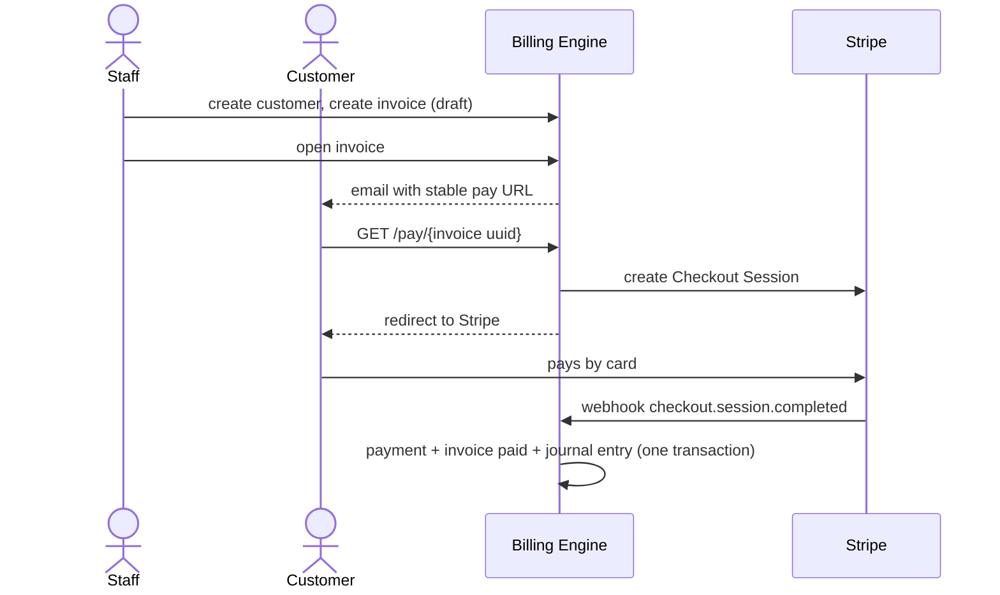
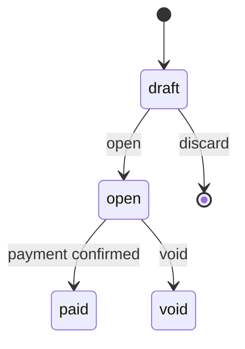
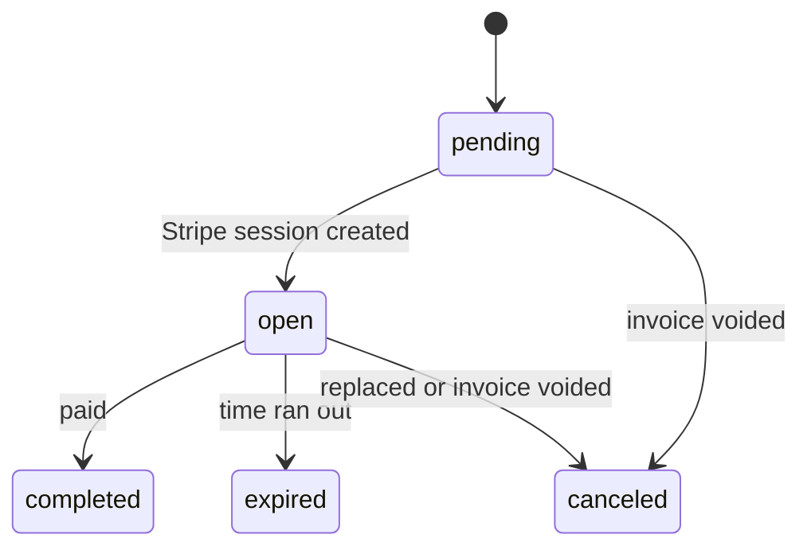
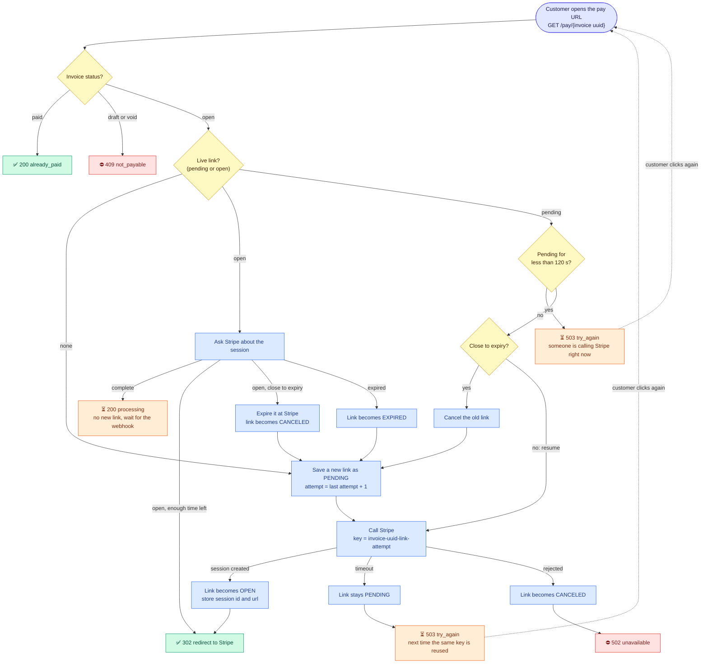
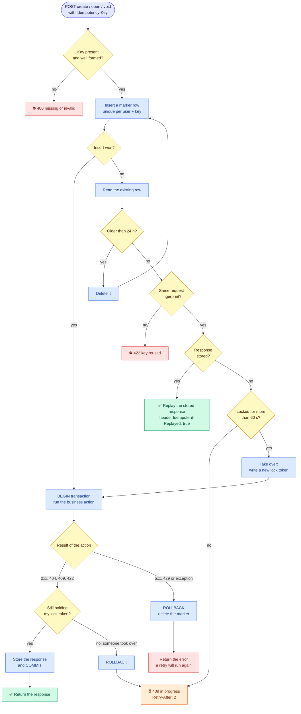

# Business Logic

How money moves through the system. Read this before the code.

## 1. Actors

| Actor          | Role                                                                        |
| -------------- | --------------------------------------------------------------------------- |
| **Staff user** | Authenticates with an API token. Manages customers, products and invoices.  |
| **Customer**   | A record only (no login). Receives invoices and pays through a stable link. |
| **Stripe**     | Hosts the payment page and confirms payments through signed webhooks.       |

## 2. The happy path

## 3. State machines

`Payment` has no status: it is a fact (money arrived). `is_applied = false` marks money
that could not be matched to an open invoice.

## 4. Step by step

### 4.1 Create the customer and the products

Staff creates customers (unique email) and maintains the product catalog.
Changing a product price never affects existing invoices.

### 4.2 Create the invoice (`draft`)

Staff sends a customer and a list of `{product, quantity}`.

1. Each product's name and unit price are **copied** onto the invoice item (snapshot).
2. `line_total = quantity x unit_price`; `subtotal` is their sum.
3. Tax (14%) is computed **once on the subtotal**, rounded half away from zero.
4. `total = subtotal + tax`; `created_by` is the staff user.

Example: Pro Plan 99.00 + 2 x Extra Seat 15.00 + Setup Fee 50.00 = 179.00,
tax 25.06, total **204.06**.

A draft has no number and no accounting entry. It can be discarded.
Rejected: no items, quantity < 1, inactive product, currency mismatch.

### 4.3 Open the invoice (`draft -> open`)

One transaction: lock the invoice, take the next number from the `sequences` table
(gap-free: a rolled-back transaction gives the number back), set `issued_at` and
`due_at` (+14 days), status `open`, then post the journal entry. An open invoice is immutable;
corrections are done by voiding and issuing a new invoice. A voided invoice keeps its number.

### 4.4 Ask the customer to pay

The customer gets a **stable URL** GET /api/v1/pay/{invoice uuid} that never changes (the invoice resource exposes it as pay_url while the invoice is open).
Stripe links expire, so a Stripe link is only created when the customer clicks.
Staff can resend the same URL at any time.

### 4.5 The customer opens the pay URL

The invoice is locked, then:

| Situation                                                      | Result                                                   | Old link       |
| -------------------------------------------------------------- | -------------------------------------------------------- | -------------- |
| Invoice is `paid`                                              | "Already paid"                                           |                |
| Invoice is `draft` or `void`                                   | Refused                                                  |                |
| No link yet                                                    | Create link (attempt 1), redirect to Stripe              |                |
| Live link, more than 30 min left, still open at Stripe         | Redirect to the **same** link                            | stays `open`   |
| Stripe says the session is expired                             | Create a new link                                        | `expired`      |
| Stripe says the session is complete (webhook not yet received) | Show "payment processing", no new link                   | unchanged      |
| Live link about to expire (< 30 min)                           | Expire it at Stripe, create a new one                    | `canceled`     |
| A `pending` link younger than 2 min                            | "Try again in a few seconds"                             |                |
| An older `pending` link (crash in the middle)                  | Resume the Stripe call with the **same idempotency key** | becomes `open` |

Creating a link: (1) save a `pending` row and commit, no lock held while calling Stripe;
(2) call Stripe with amount, expiry, `client_reference_id` and the idempotency key
`invoice-{invoice uuid}-link-{attempt}`; (3) store the session id and URL, status `open`.
At most **one live link (`pending` or `open`) per invoice**, enforced by a partial unique index.

#### Payment link flow

The row created on the first click lives in `payment_links` (a `payments` row only exists once the
webhook confirms the money arrived). There is **no background retry**: every new click by the
customer is the retry.

| Customer action                             | Result                                                                                                                   |
| ------------------------------------------- | ------------------------------------------------------------------------------------------------------------------------ |
| First click                                 | Redirect to Stripe, or `503` if Stripe timed out (the link stays `pending`)                                              |
| Clicks again within 120 s of a pending link | `503 try_again`, no new call to Stripe                                                                                   |
| Clicks again after 120 s                    | The same Stripe call is resumed with the same idempotency key; Stripe returns the same session if it already created one |
| The link expired or is about to             | The old link is closed (`expired` / `canceled`) and a new attempt is created                                             |
| Paid, webhook not received yet              | `200 processing`, no new link                                                                                            |

Inside one request the code loops at most 3 rounds, which only matters when an old link must
be retired and a new attempt created.

### 4.6 Paying on Stripe

Declined cards are retried inside Stripe's page; we see nothing.
The success redirect is **never trusted**; only the webhook confirms a payment.
Card only, full invoice amount only.
The success page reads the invoice status from the database and refreshes until the webhook has marked it paid.

### 4.7 The webhook (`checkout.session.completed`)

Endpoint: verify signature and timestamp (bad = 400), store the event by its unique id
(duplicate = ignore, still 200), queue it, answer 200.
Job (one transaction, invoice locked before link): find the link by `client_reference_id`,
check amount and currency.

| Situation                                                                                                     | Payment                                                                       | Invoice   | Link        | Journal entry                                                      |
| ------------------------------------------------------------------------------------------------------------- | ----------------------------------------------------------------------------- | --------- | ----------- | ------------------------------------------------------------------ | --- |
| Normal                                                                                                        | `is_applied = true`                                                           | `paid`    | `completed` | Dr Gateway Clearing / Cr Receivable                                |
| Paid on a link our database already marked `expired` (the webhook arrived late) and the invoice is still open | New payment, `is_applied = true` (same as the normal case; the money is real) | `paid`    | `completed` | Dr Gateway Clearing / Cr Receivable                                |     |
| Invoice already `paid` (second link)                                                                          | `is_applied = false`                                                          | unchanged | `completed` | Dr Gateway Clearing / Cr Unapplied Payments, then automatic refund |
| Invoice `void`                                                                                                | `is_applied = false`                                                          | unchanged | `completed` | same as above                                                      |
| Amount or currency mismatch                                                                                   | `is_applied = false`                                                          | unchanged | `completed` | same as above, flagged for review                                  |
| Session not ours                                                                                              |                                                                               |           |             | ignored                                                            |
| Same event twice                                                                                              | not processed again                                                           |           |             |                                                                    |
| Job fails                                                                                                     |                                                                               |           |             | retry with backoff, then dead-letter + replay command              |
| Webhook never arrives                                                                                         |                                                                               |           |             | reconciliation finds it                                            |

The link status is only our bookkeeping and can lag behind Stripe, so it is never used to decide whether money is accepted; only the invoice state, the amount and the currency are.
After commit, any other live link of the invoice is expired at Stripe and marked `canceled`.

### 4.8 Refund (full or partial)

Staff requests an amount on a payment. Under a lock on the payment: sum of refunds

- new amount must not exceed the amount paid. The refund is recorded `pending`, sent to Stripe with
  an idempotency key, and confirmed by webhook (`succeeded` or `failed`; failed posts nothing).
  The amount is split between revenue and tax in the invoice's proportion (no cent lost).
  The invoice stays `paid`; the refund is its own document.

### 4.9 Void

| Invoice | Result                                                                  |
| ------- | ----------------------------------------------------------------------- |
| `draft` | Discard: deleted, no number, no entry                                   |
| `open`  | `void`: reversing entry, every live link canceled and expired at Stripe |
| `paid`  | Not allowed: refund first                                               |

### 4.10 Late invoices

Passing `due_at` does not change the status. The invoice shows up in the AR Aging report.

### 4.11 Retrying API calls safely (`Idempotency-Key`)

`POST /invoices`, `POST /invoices/{id}/open` and `POST /invoices/{id}/void` require an
`Idempotency-Key` header (8-255 characters: letters, digits, `-`, `_`; a UUID is recommended).
One key per user intention; reuse it only to retry the same request.

| Situation                                         | Response                                                                         |
| ------------------------------------------------- | -------------------------------------------------------------------------------- |
| First request with the key                        | Executed; the response is stored for 24 hours                                    |
| Same key, same request, after it finished         | The stored response with `Idempotent-Replayed: true`                             |
| Same key while the first request is still running | `409 idempotency_in_progress` + `Retry-After`                                    |
| Same key, different body or endpoint              | `422 idempotency_key_reused`                                                     |
| Missing or malformed key                          | `400 idempotency_key_missing` / `idempotency_key_invalid`                        |
| First request failed with 5xx or 429              | Nothing stored, key released, a retry executes again                             |
| Deterministic errors (404, 409, 422)              | Stored and replayed                                                              |
| Request running for more than 60 s                | Taken over by the next attempt; the old one can no longer commit (fencing token) |

The marker row is committed first; the business work and the stored response commit in one
transaction, so "invoice created but no stored response" cannot happen. Keys are scoped per user.

#### Idempotency flow

## 5. Journal entries

| Event                          | Debit                                | Credit                               |
| ------------------------------ | ------------------------------------ | ------------------------------------ |
| Invoice opened                 | 1100 Accounts Receivable (total)     | 4010 Sales Revenue, 2100 Tax Payable |
| Payment applied                | 1010 Gateway Clearing                | 1100 Accounts Receivable             |
| Payment not applied            | 1010 Gateway Clearing                | 2200 Unapplied Payments              |
| Refund of an applied payment   | 4020 Sales Refunds, 2100 Tax Payable | 1010 Gateway Clearing                |
| Refund of an unapplied payment | 2200 Unapplied Payments              | 1010 Gateway Clearing                |
| Open invoice voided            | 4010 Sales Revenue, 2100 Tax Payable | 1100 Accounts Receivable             |

## 6. Rules that always hold

- Money is an integer in minor units; arithmetic goes through `Money`.
- Every journal entry balances (debits = credits); a database trigger enforces it.
- Receivable (1100) always equals the sum of open invoices.
- Stripe's webhook is the only proof of payment.
- One live payment link per invoice.
- Every state change happens under a row lock.

## 7. Out of scope (v1)

Partial or over-payments, non-card methods, currencies other than USD, Stripe fees and
payouts, automatic reminders, credit notes.

## 8. Implementation status

| Step                                                                 | Status  |
| -------------------------------------------------------------------- | ------- |
| 4.1 - 4.3 Customers, products, invoices: create, open, void, discard | ✅ Done |
| Staff authentication with API tokens                                 | ✅ Done |
| 4.4 - 4.5 Stable pay URL and payment links (fake gateway)            | ✅ Done |
| 4.6 Customer-facing result pages                                     | ✅ Done |
| 4.11 Idempotency-Key                                                 | ✅ Done |
| Stripe over HTTP and 4.7 Webhooks                                    | Phase 3 |
| Journal entries (section 5)                                          | Phase 4 |
| 4.8 Refunds                                                          | Phase 5 |
